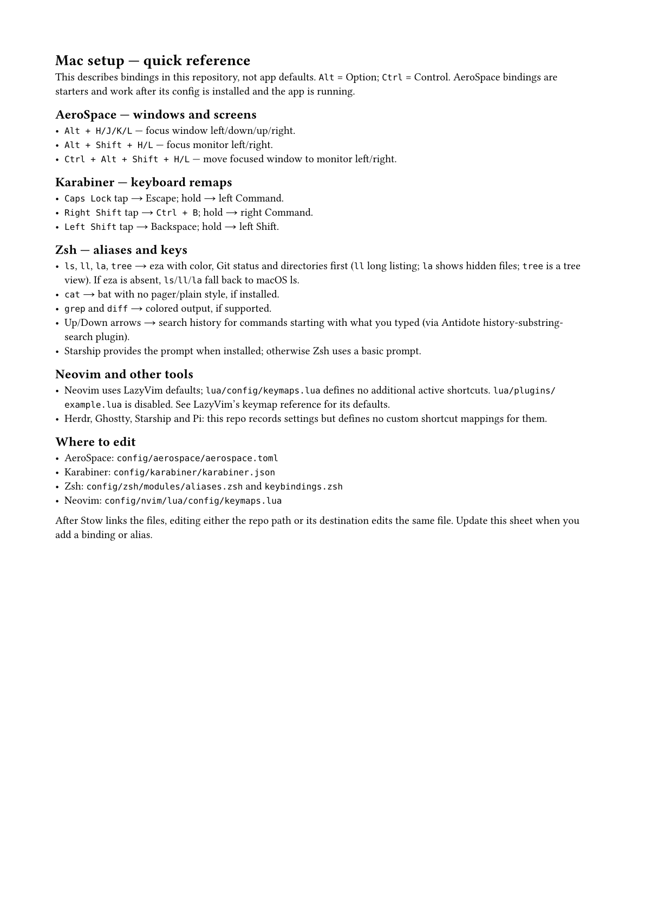

# macOS dotfiles

Homebrew installs tools; GNU Stow links curated settings into place. Review the [Brewfile](Brewfile) and [bootstrap script](scripts/bootstrap.sh) before running `./scripts/bootstrap.sh` (it backs up conflicting files, but authentication and macOS permissions remain manual).

## Layout

`config/` mirrors `~/.config/`; `home/` mirrors other paths under `~/`, so editing a linked config updates the file in this repo. `pi-settings.example.json` seeds new Pi installs only; Pi plugins live in [pi-workbench](https://github.com/NhanChau2409/pi-workbench), while credentials, caches, history, and machine-specific state stay out of Git.

## Add a tool

Add its Homebrew formula/cask to `Brewfile` if applicable, and put only safe, static settings under `config/<tool>/` or `home/<path>` to match the tool's actual config path. Back up any existing file before linking with Stow (or run the bootstrap), then update the cheatsheet if you added bindings or aliases.

## Cheatsheet

[Open the PDF](docs/cheatsheet.pdf) · [Edit the Typst source](cheatsheet.typ)

